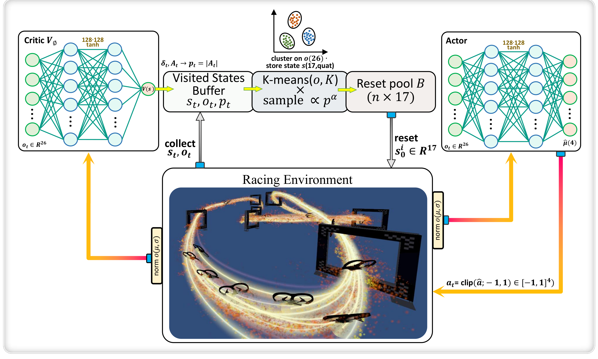

# Prioritized Initial-State Buffer (P-ISB)

Code accompanying *Prioritized Initial-State Buffers for Agile Drone Racing*
(under double-anonymous review). This version matches the revised manuscript;
the first release is kept in the repository history.

P-ISB decides **where** an on-policy agent is reset from. Each visited state is
scored by the magnitude of the critic's advantage, |A|, the visited states are
clustered with k-means, a cluster is chosen uniformly and a state is drawn
within it with probability proportional to (|A| + eps)^alpha. The method adds
no network and reuses the advantage PPO already computes. Its corners are
plain PPO (rho = 0), a clustering-only buffer (alpha = 0) and priority-only
sampling (K = 1).



*The P-ISB training loop. Visited states enter the buffer with priority
|A_t| from the critic; the buffer is clustered on the 26-D observation, a
reset pool of full 17-D simulator states is drawn by priority within
clusters, and the racing environment resets from that pool.*

## Contents

```
.
├── rpg_baselines/pisb_ral/     # the buffer and every reset-selection arm
│   ├── buffers.py              #   visited-state FIFO, k-means, selection rules
│   ├── controllers.py          #   PISBRALController: vanilla/random/obs/cl/pisb/signed/refresh
│   └── ref_cl.py               #   CL-Buffer: port of the reference implementation
├── scripts/
│   ├── run_pisb_ral.py         # train one arm (racing)
│   ├── run_pisb_resume.py      # continue a finished 150M run to 300M
│   ├── run_drone_racing.py     # env builder, parser and training callback it reuses
│   ├── eval_metrics.py         # success, crash rate and body rate from the fixed start
│   ├── lap_times.py            # lap times (mean action)
│   └── signflip.py             # the paired sign-flip and best-lap permutation tests
├── configs/                    # racing env config and the three tracks
├── docs/pisb_overview.png      # overview figure
├── legged/pisb_legged/         # locomotion experiments (legged_gym / rsl_rl)
└── INTEGRATION.md              # the hooks P-ISB needs from a PPO runner and an env
```

## Drone racing

### Requirements

Python 3.7, TensorFlow 1.15, stable-baselines 2.10, NumPy, SciPy, PyYAML,
ruamel.yaml (`requirements.txt`), and PyTorch for the CL-Buffer arm only.

The scripts run on a Flightmare checkout whose racing environment
`QuadrotorRacingEnv_v0` exposes the hooks listed in `INTEGRATION.md`, with its
Python bindings (`flightgym`) importable and `FLIGHTMARE_PATH` set. Copy
`rpg_baselines/pisb_ral/` into the checkout's `flightrl/rpg_baselines/`, the
contents of `scripts/` into `flightrl/scripts/`, and `configs/racing.yaml` to
`flightlib/configs/quadrotor_racing_env.yaml`. The PPO runner
(`rpg_baselines/ppo/ppo2.py`) must call the buffer as described in
`INTEGRATION.md`.

### Settings

The values used for every result in the paper (Table I of the manuscript):

| | |
|---|---|
| PPO | 100 envs x 250 steps per update, 150M steps, lr 3e-4, clip 0.2, gamma 0.995, lambda 0.95, 10 epochs, 4 minibatches |
| Buffers | alpha 0.7, K 64, pool n 256, capacity N 20000, g_min 1, eps 1e-3 |
| Reset probability | rho = 0.4 for every buffer, 0 until 10% of training, then linear to 0.4 at 40% |
| Reward shaping | tracking, alignment and survival terms decay linearly to 0, and the gate bonus from 150 to 50, over the first 60% of training |
| Seeds, *Split-S* | 0 6 7 8 13 21 42 56 92 100 |
| Seeds, *ellipse*, *AlphaPilot* | 0 6 7 8 13 |

Every method, `vanilla` included, draws the resets it does not take from a
buffer from the environment's base distribution: 30% at the race start and
70% at a uniform point along a randomly chosen gate segment, flying along it
at 3 m/s. Evaluation always starts from the race start.

### Training

One run of the main comparison (`--pr_arm` is one of `vanilla random obs cl pisb`):

```bash
python scripts/run_pisb_ral.py --pr_arm pisb --pr_alpha 0.7 --seed 0 \
    --train 1 --mode fixed --norm_obs 1 \
    --num_envs 100 --num_threads 10 --n_steps 250 --total_timesteps 150000000 \
    --past_traj_target 0.4 --past_traj_ramp_start 0.1 --past_traj_ramp_end 0.4 \
    --pr_pool 256 --pr_k 64 --pr_capacity 20000 --pr_gate_min 1 \
    --ckpt_every 500 --save_dir runs/pisb_s0
```

The track is set by `track: yaml_path` in the racing config.

Ablations change one flag of this command: `--pr_alpha`, `--pr_k`,
`--past_traj_target` (rho), `--pr_gate_min`, `--pr_pool`,
`--pr_rho_decay_start 0.5 --pr_rho_decay_end 1.0` (anneal rho to zero), or
`--pr_arm signed` / `--pr_arm refresh` (priority variants). The clustering-only
corner is `--pr_arm pisb --pr_alpha 0`; it is a different estimator from
`--pr_arm obs`, which is the reference's observation-clustering strategy.

Continuing a finished run from 150M to 300M steps keeps the rho ramp and the
shaping schedule at their final values:

```bash
python scripts/run_pisb_resume.py <the flags of the original run> \
    --rs_zip runs/pisb_s0/saved/<stamp>.zip --rs_dir runs/pisb_s0/saved/<stamp> \
    --total_timesteps 150000000 --save_dir runs/pisb_s0_ext
```

`--total_timesteps` is the length of the continuation.

### Evaluation

Success at one lap (7 gates on *Split-S*) or five laps (35), crash rate and
body rate, from 50 roll-outs of 40 s with sampled actions:

```bash
python scripts/eval_metrics.py -w runs/pisb_s0/saved/<stamp>.zip \
    --track flightlib/configs/SplitS.yaml --num_rollouts 50 \
    --from_start --stochastic --success_gates 35 --json_out pisb_s0.json
```

The JSON also holds the gates reached by every roll-out, so any lap threshold
can be computed from one pass. Without `--stochastic` all roll-outs from the
fixed start are identical and success can only be 0 or 100%. The reported
numbers were scored without `--seed`; pass `--seed` to make a re-scoring
bit-reproducible.

Lap times use the mean action over every completed lap in 50 roll-outs of 50 s:

```bash
python scripts/lap_times.py -w runs/pisb_s0/saved/<stamp>.zip \
    --track flightlib/configs/SplitS.yaml --num_rollouts 50 --json_out laps.json
```

### Statistics

Methods are compared on per-seed values with an exact paired sign-flip test,
and a fastest lap with a permutation test on the best of a random group of
seeds:

```bash
python scripts/signflip.py paired --a <P-ISB per seed> --b <baseline, same seed order>
python scripts/signflip.py record --method <P-ISB per seed> --pool <all methods' per seed>
```

### Implementation notes

- When one iteration inserts more states than the capacity (100 envs x 250
  steps after the g_min filter can exceed 20000), the buffer keeps the most
  recent ones. Every reported racing result uses this behaviour, for every
  buffer; `VisitedBuffer(fifo_uniform=True)` keeps a uniform subsample instead.
- Priorities are computed once, at insertion. The buffer turns over about once
  per iteration; `pisb/buf_turnover_iters` in `progress.csv` logs it.

## Locomotion

`legged/pisb_legged` runs the four buffers on ANYmal-C rough terrain with
legged_gym (commit 8fa29ac) on Isaac Gym Preview 4 and rsl_rl 1.0.2. The
Random-, Obs- and CL-Buffer arms call the reference implementation's
`initial_buffer` library unmodified; install it before training. legged_gym
and rsl_rl are not modified: the package only subclasses them.

Copy `legged/pisb_legged` into the legged_gym checkout. The launcher trains
`ARMS` (default `vanilla random obs cl pisb`) x `SEEDS` (default
`0 6 7 8 13`). The four settings in the paper:

```bash
# single start, 1024 envs x 2000 iterations
SINGLE_START=1 NENVS=1024 ITERS=2000 CAPACITY=25000 bash pisb_legged/run_local.sh
# default setup, 2048 envs x 6000 iterations
NENVS=2048 ITERS=6000 CAPACITY=50000 bash pisb_legged/run_local.sh
# single start at the larger budget
SINGLE_START=1 NENVS=2048 ITERS=6000 CAPACITY=50000 bash pisb_legged/run_local.sh
# single start on the easiest patch of the same terrain type
SINGLE_START=1 START_ROW=0 START_COL=10 NENVS=1024 ITERS=2000 CAPACITY=25000 \
    bash pisb_legged/run_local.sh
```

Give each setting its own output tree with `OUT=...`, then validate it:

```bash
python pisb_legged/validate_legged.py --runs <OUT>
```

Every policy is scored by validation reward from the centre of all 200 terrain
patches for 2000 steps, not by training reward, which each method collects
under its own reset distribution. Locomotion uses rho = 0.8, as in the
reference.

## License

MIT, see `LICENSE`.
